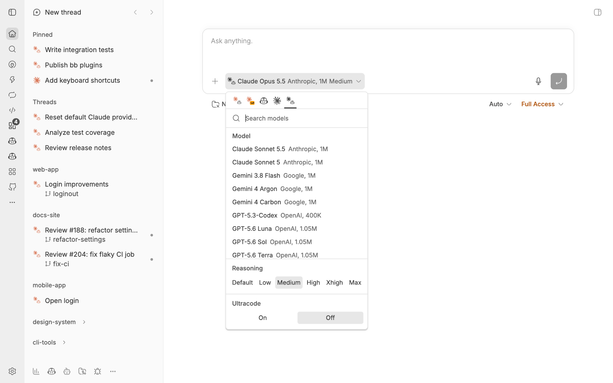
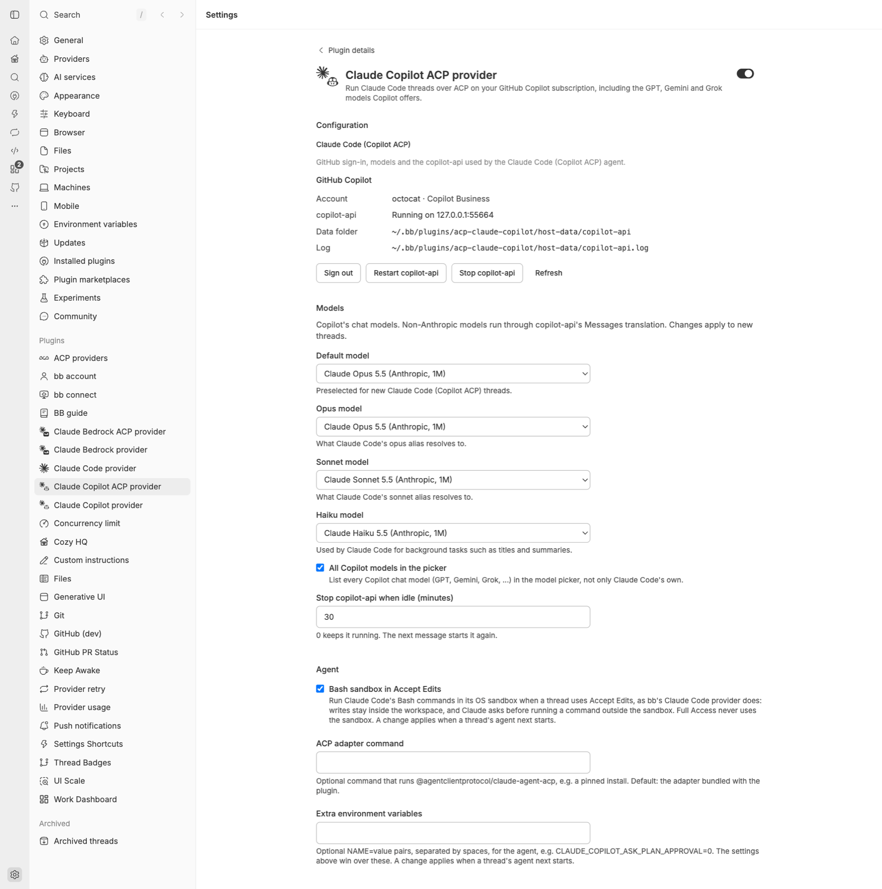
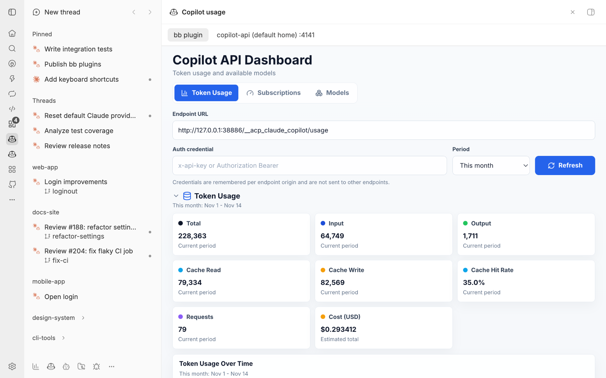

# bb-plugin-acp-claude-copilot

Claude Code on your **GitHub Copilot** subscription as an ACP agent in
[bb](https://getbb.app), shown as **Claude Code (Copilot ACP)** in the provider
picker. Claude Code runs through its own copy of
[copilot-api](https://github.com/caozhiyuan/copilot-api), which turns Copilot
into an Anthropic Messages API. Besides Claude, you can pick Copilot's GPT,
Gemini, Grok and other chat models per thread.

It is the ACP variant of the Claude Copilot provider plugin
(`bb-plugin-claude-copilot`). The two are independent: neither needs the
other, and both can be installed at the same time without getting in each
other's way. Each has its own provider, GitHub sign-in, copilot-api, port and
key.

It has these parts:

- `bin/claude-copilot-acp`: the launcher. It runs Claude Code over ACP with
  [`@agentclientprotocol/claude-agent-acp`](https://www.npmjs.com/package/@agentclientprotocol/claude-agent-acp).
- `bin/claude-copilot-acp-proxy.mjs`: a small ACP proxy started by the
  launcher. It starts copilot-api when it isn't running, points Claude Code at
  it, puts every Copilot model in the model picker, runs Bash in Claude Code's
  sandbox in Accept Edits (see
  [Permission modes and the sandbox](#permission-modes-and-the-sandbox)), hides
  the subagent picker option, removes Claude Code's cost estimate, and makes
  plan mode ask before it implements (see [Plan mode](#plan-mode)).
- `bin/copilot-api.mjs`: copilot-api's state, start and stop, used by the proxy
  and the plugin.
- The bb plugin. It registers the launcher as the custom agent `claude-copilot`
  (provider `acp-claude-copilot`) in bb's ACP agents plugin and keeps that
  entry up to date, declares bb's permission modes and `/compact` for it, and
  passes the plugin settings to the agent. It gives the
  provider the Claude mark and the Copilot glyph as its icon, monochrome to
  tell it apart from the colored icon of the Claude Copilot provider plugin.
  It has the same settings page and **Copilot usage** page as the Claude
  Copilot provider plugin, shows each thread's Copilot credits above the
  prompt (see [In bb](#in-bb)),
  and adds the Copilot premium-request quota to bb's Provider usage panel. It
  uses only the public plugin SDK.

## Screenshots

**Claude Code (Copilot ACP)** in the model picker, with Copilot's GPT and
Gemini models next to the Claude models:



Settings: GitHub sign-in and copilot-api state first, then the model mapping.



The **Copilot usage** page: copilot-api's token usage dashboard inside bb.



## In bb

- **Settings → Claude Copilot ACP provider**: one section, owned by the plugin
  (not bb's declarative form) so it can be ordered and use live data: GitHub
  sign-in (device code), account and copilot-api state (start / stop /
  restart); model dropdowns from Copilot's model list (default model, Opus /
  Sonnet / Haiku mapping, all Copilot models in the picker) and idle-stop
  minutes; the Bash sandbox in Accept Edits and the ACP adapter
  command; copilot-api's `config.json` (saving reloads it; the
  plugin-managed gateway keys are hidden and preserved). The settings are kept
  in the plugin's storage and written to the agent entry's `env`.
- **Copilot usage** page and sidebar-footer button: copilot-api's usage
  dashboard in a sandboxed iframe whose data requests go through the plugin
  (`/viewer`, `/proxy` routes), so it works from bb on a phone too. Tabs at
  the top switch between local copilot-api instances: this plugin's (default)
  and any other copilot-api home with a usage database, except other bb
  plugins' own (found from running copilot-api processes and the default
  `~/.local/share/copilot-api`). Other
  instances are read from a read-only snapshot (`VACUUM INTO`) with
  copilot-api's own query code (`usage-reader.mjs`).
- **Copilot credits above the prompt**: the Copilot AI credits the thread's
  Claude Code session has used so far, as copilot-api recorded them (keyed by
  the session id, which the ACP adapter uses as Claude Code's session id), in
  the thread's context row next to bb's changed files. Click it for a
  breakdown by model. Only on Claude Code (Copilot ACP) threads. While a window
  shows it, the plugin checks the session's usage every 5 seconds and updates
  the value when it changes; the window itself doesn't poll.

## Requirements

- bb 0.49 or later, with the built-in ACP agents plugin (`provider-acp`).
- A GitHub Copilot subscription. Model availability and premium-request use
  follow your Copilot plan.
- Node.js and [Claude Code](https://claude.com/claude-code) (`claude` on PATH).
  Without `claude`, the ACP adapter uses its bundled Claude Code.

## Setup

1. Install the plugin. From a clone:

   ```sh
   git clone https://github.com/alexkli/bb-plugin-acp-claude-copilot.git
   cd bb-plugin-acp-claude-copilot
   npm install
   bb plugin build
   bb plugin install .
   ```

   On load, the plugin adds **Claude Code (Copilot ACP)** to bb's ACP agents.
   It updates that entry on every load and settings change, so a plugin update
   that moves the launcher needs no action. Other custom agents are left
   alone. If it can't (for example because the ACP agents plugin is disabled),
   bb shows the plugin as needing configuration, with the reason.

2. Sign in to GitHub: Settings → Plugins → **Claude Copilot ACP provider** →
   **Sign in with GitHub** (at the top), then enter the code on github.com. Or run
   `bb acp-claude-copilot login`. Check the setup with
   `bb acp-claude-copilot status`.

3. The ACP adapter ships with the plugin as a dependency, pinned to an exact
   version (`@agentclientprotocol/claude-agent-acp`, installed by
   `npm install`), so there is nothing to install. To use a different one,
   point **ACP adapter command** at it, e.g.
   `node /path/to/node_modules/@agentclientprotocol/claude-agent-acp/dist/index.js`.

4. Pick **Claude Code (Copilot ACP)** in a new thread.

## copilot-api

The plugin runs its own copilot-api, pinned in `package.json`, with its own
home (`~/.bb/plugins/acp-claude-copilot/host-data/copilot-api`), a random
port and a generated gateway key. A machine-wide copilot-api, its
`~/.local/share/copilot-api` and port 4141 are not used, and neither is the
Claude Copilot provider plugin's copilot-api.

When a thread starts, and again before each message, the proxy starts
copilot-api if it isn't running. A lock file makes sure that threads starting
at the same time start only one. copilot-api runs detached and serves all
threads. The plugin stops it when no Claude Code (Copilot ACP) thread has been
running for the configured minutes (**Stop copilot-api when idle**, default
30; 0 keeps it running); the next message starts it again on the same port.

The proxy only starts copilot-api after a GitHub sign-in. When copilot-api
can't serve a message (not signed in, or it didn't start), bb gets the message
back as an error that says why and where to look, and the adapter never sees
it.

```sh
bb acp-claude-copilot login    # sign in to GitHub Copilot (device code)
bb acp-claude-copilot logout   # sign out of GitHub Copilot
bb acp-claude-copilot start    # start copilot-api
bb acp-claude-copilot stop     # stop copilot-api
```

See also [Commands](#commands). copilot-api's log: `~/.bb/plugins/acp-claude-copilot/host-data/copilot-api.log`.

## Models

The model picker lists **every Copilot chat model**, named as Copilot names
them (e.g. "GPT-5 (OpenAI, 400K)"). They use copilot-api's Claude Code
convention: Claude models keep their ids (`claude-sonnet-5-5`), other models
get a `my-claude-` prefix (`my-claude-gpt-5`), and models with a 1M window a
`[1m]` suffix.

How: the proxy reads Copilot's model list from copilot-api and passes it to
the ACP adapter as an `availableModels` allowlist in `CLAUDE_MODEL_CONFIG`. The
adapter lists an allowlisted model that Claude Code doesn't know as a picker
row of its own and accepts it when bb sets the model. Simply adding rows to
the picker in the proxy would not work: the adapter checks a picked model
against its own list and rejects anything else ("Invalid value for config
option model").
Tested with claude-agent-acp 0.107.3, the version the plugin bundles. When Claude Code switches to a model, it
sends the model a one-token request first; with Copilot that is one small
request per switch.

Turn **All Copilot models in the picker** off to get only Claude Code's own
picker (Default, Opus, Sonnet, Haiku). If you set `CLAUDE_MODEL_CONFIG` in the
agent's `env` yourself, the proxy leaves it alone.

**Default model** sets `ANTHROPIC_MODEL`, the model of the "Default" row.
**Opus / Sonnet / Haiku model** set the Copilot models behind Claude Code's
aliases (`ANTHROPIC_DEFAULT_*_MODEL`). Claude Code also uses those for
subagents and background tasks.

### Settings and launcher variables

The plugin passes its settings (from its settings page) to the agent as
environment variables in the agent entry. You can add more variables to the entry's `env` in the ACP agents
settings; the plugin keeps them.

| Setting | Variable | Default |
| --- | --- | --- |
| Default model | `ANTHROPIC_MODEL` | `claude-opus-5-5` |
| Opus model | `ANTHROPIC_DEFAULT_OPUS_MODEL` | `claude-opus-5-5` |
| Sonnet model | `ANTHROPIC_DEFAULT_SONNET_MODEL` | `claude-sonnet-5-5` |
| Haiku model | `ANTHROPIC_DEFAULT_HAIKU_MODEL` | `claude-haiku-5-5` |
| All Copilot models in the picker | `CLAUDE_COPILOT_ALL_MODELS` (`0` when off) | on |
| Bash sandbox in Accept Edits | `CLAUDE_COPILOT_SANDBOX` (`0` turns it off) | on (unset) |
| ACP adapter command | `CLAUDE_AGENT_ACP` | the plugin's bundled adapter, else `claude-agent-acp` on PATH, else `npx` |
| (data folder) | `CLAUDE_COPILOT_DATA_DIR` | the plugin's `host-data` folder |

Launcher-only variables: `CLAUDE_CODE_EXECUTABLE` (default `claude` on PATH),
`CLAUDE_COPILOT_ACP_HIDE_OPTIONS` (default `agent`, comma-separated ACP config
options to hide) and `CLAUDE_COPILOT_ASK_PLAN_APPROVAL` (see below). The
launcher also sets what the Claude Copilot provider plugin sets for Claude
Code on Copilot: `CLAUDE_CODE_AUTO_MODE_SERVER=0`,
`CLAUDE_CODE_DISABLE_NONESSENTIAL_TRAFFIC=1`, the `DISABLE_*` flags,
`CLAUDE_CODE_ATTRIBUTION_HEADER=0` and `CLAUDE_COPILOT_SESSION=1`. Each launch
appends one line (time, data folder, model, adapter; no keys) to
`~/.local/state/claude-copilot-acp/launcher.log`.

## Permission modes and the sandbox

bb offers ACP agents two permission modes, **Accept Edits** and **Full
Access**. The plugin declares both in the agent entry (`permissionCli`): bb
starts the launcher with `--bb-permission-mode=accept-edits` or
`--bb-permission-mode=full`, and restarts the agent with the new value when a
thread's mode changes. The proxy takes that argument off the adapter's command
line.

In **Accept Edits** the proxy runs Claude Code's Bash commands in its OS
sandbox, with the same settings bb's own Claude Code provider uses: writes stay
inside the workspace and the thread's extra folders (such as its storage
folder), sandboxed commands run without a prompt, local servers can listen, and
Claude asks before it runs a command outside the sandbox. bb shows that request
as an approval. Claude may still edit files inside the workspace from Bash (bb
shows no diff for those); when Bash can't write somewhere, it switches to its
Edit and Write tools, which bb shows as file changes with diffs. In **Full
Access** there is no sandbox, as in bb's Claude Code provider. The sandbox
applies only to Bash commands; Claude Code's own requests to copilot-api aren't
affected.

Turn the sandbox off with **Bash sandbox in Accept Edits** in the settings. A
change applies when a thread's agent next starts. The proxy adds the sandbox
to `_meta.claudeCode.options` of every session start; a sandbox the client
sets itself wins. Claude Code's own permission mode (Auto, Default, ...) is a
separate session option of the adapter and isn't changed.

`/compact` is available in the composer (`supportsManualCompaction`): the
adapter runs Claude Code's own compaction.

## Plan mode

In plan mode, Claude ends planning with "Ready to code?", which the ACP
adapter sends to bb as a permission request. In Full Access, bb answers every
permission request itself, so the plan would be approved without asking you
and Claude would go straight to implementing. The proxy holds that request
and instead:

- adds a link to the plan to Claude's message ("Plan ready for review"),
  which bb opens in the side panel: the file Claude wrote under
  `~/.claude/plans/`, or a copy of the plan text in the thread's storage
  folder;
- asks you a question, which bb shows in every permission mode, with
  Claude's options, such as "Yes, and use auto mode", "Yes, manually approve
  edits" and "No, keep planning" (at most four; bb can't show more).

Your answer goes back to Claude as the permission decision. To change the
plan, pick "No, keep planning": Claude stays in plan mode and the turn ends,
so send your feedback as a message and Claude revises the plan. Dismissing
the question also keeps Claude in plan mode. Set
`CLAUDE_COPILOT_ASK_PLAN_APPROVAL=0` in the agent's `env` to leave the request
to bb instead.

## Usage

The plugin adds the Copilot **premium-request quota** to bb's Provider usage
panel and footer: percent used and the reset date; the expanded row shows the
used and entitled amount in dollars (an AI credit is $0.01, a premium request
$0.04). Background polls never start copilot-api and show the last value; a
refresh starts it.

Threads show no cost from Claude Code: it estimates cost at Anthropic list
prices, which says nothing about Copilot billing, so the proxy removes it.
Token counts and the context meter stay, and the credits in the context row
above the prompt show what the session used in Copilot AI credits.

bb lists the entry under the raw provider id, because ACP custom agents don't
have the usage capability.

## Commands

```sh
bb acp-claude-copilot status      # launcher, adapter, agent entry, provider, sign-in, copilot-api
bb acp-claude-copilot repair      # rewrite the agent entry from the plugin settings
bb acp-claude-copilot unregister  # remove the agent entry
```

`status` exits non-zero when something needs attention (including a missing
GitHub sign-in; a stopped copilot-api is normal) and never prints keys. bb has
no uninstall hook, so remove the agent entry before removing the plugin:

```sh
bb acp-claude-copilot unregister
bb plugin remove acp-claude-copilot
```

## Development

`npm run build` (`bb plugin build .`) compiles the plugin into `dist/`, and
`bb plugin reload acp-claude-copilot` reloads it. `npm run typecheck`
type-checks it. `npm test` runs the tests: the proxy and launcher end to end
against a fake adapter and a fake copilot-api (permission modes and the
sandbox, models, plan approval; none of your own Claude Code, Copilot or bb
environment reaches them), copilot-api's state handling, start and stop, the
agent entry, and the plugin itself on the SDK's fake host (agent entry, setup
errors, commands, the credits watch). CI runs the typecheck and tests on every
push and pull request. The plugin's agent skill is in
`skills/claude-copilot-acp/SKILL.md`; bb gives it to agents in every thread.

## License

MIT
